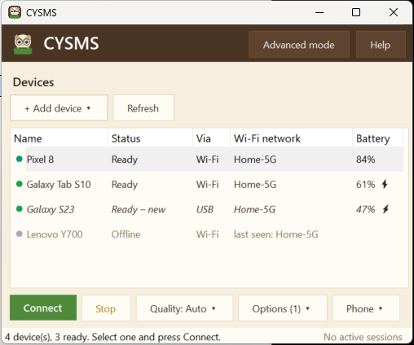
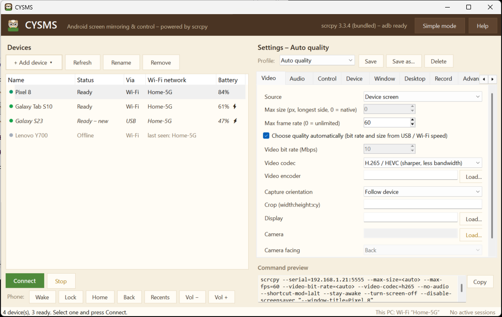
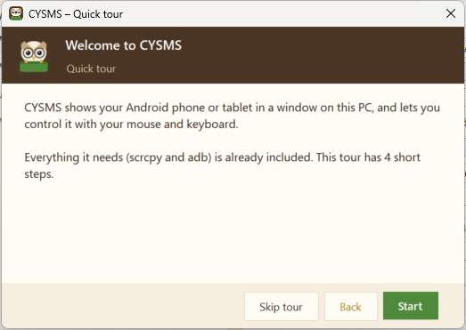

# CYSMS

**See and control your Android phone or tablet from a Windows PC.** CYSMS is a friendly front end for [scrcpy](https://github.com/Genymobile/scrcpy): pick a device, press Connect, and its screen opens in a window you can use with your mouse and keyboard. scrcpy and adb are included, so there is nothing else to install.

## What it does

- **One-click mirroring** over USB or Wi-Fi, with several devices at once.
- **Simple mode** keeps to a few choices: Quality (Auto, Smooth, Balanced, Sharp) and Options (phone sound on the PC, screen off, always on top, view only). On Auto, CYSMS picks the picture size and bit rate from the connection.
- **Advanced mode** exposes every scrcpy option, grouped into tabs, with named profiles per device and a live preview of the exact command.
- **Wireless without the fiddling:** switch a plugged-in phone to Wi-Fi in one click, pair with a code, scan the network, or add by IP address. Saved phones are switched back to Wi-Fi automatically after a restart when you plug them in.
- **Know which device is which:** the list shows each device's Wi-Fi network name, battery level and Android version, and tells you when a phone is on a different network from the PC.
- **Phone buttons** from the PC: wake, lock, home, back, recents, volume and screenshot.
- **Extras from scrcpy:** recording, phone camera as the source, a separate virtual display that starts an app, keyboard/mouse/gamepad modes.
- **Quick tour** on first run (Help > Quick tour to see it again).

## Download and run

You do not need to install anything or use git.

1. Open the **[Releases](../../releases/latest)** page of this repository.
2. Under **Assets**, download `CYSMS-vX.Y.Z-portable.zip`.
3. Right-click the zip > **Extract All**, and put the `CYSMS` folder anywhere you like.
4. Open the folder and double-click **CYSMS.exe**.

Good to know:

- **"Windows protected your PC"** may appear the first time, because the file is not code-signed. Choose **More info > Run anyway**. (A Microsoft Store version, which does not show this, is planned.)
- Keep the `scrcpy` folder next to `CYSMS.exe`.
- To update, download the newer zip and replace the folder. Your devices and settings are kept separately in `%LOCALAPPDATA%\CYSMS`.
- To remove CYSMS, delete the folder (and `%LOCALAPPDATA%\CYSMS` if you also want to remove your settings).

See [Compatibility](#compatibility) below for which Windows and Android versions work.

## Compatibility

### Windows

| Windows | Supported | Notes |
|---|---|---|
| Windows 11, 64-bit (x64) | Yes | |
| Windows 11 on ARM | Yes | The included 64-bit scrcpy runs under Windows 11's x64 emulation. |
| Windows 10 version 1903 or later, 64-bit | Yes | .NET Framework 4.8, which CYSMS needs, is built in from 1903. |
| Windows 10 on ARM | No | Can't run the included 64-bit scrcpy. You can try the 32-bit `scrcpy-win32` from the [scrcpy releases](https://github.com/Genymobile/scrcpy/releases) with **Locate scrcpy.exe**. |
| 32-bit Windows 10 | No | Same workaround: use `scrcpy-win32`. |
| Windows 10 before 1903, Windows 8.1, Windows 7 | No | Not tested and not supported. |

If CYSMS starts on an unsupported PC, it says so once and explains the workaround. When the included scrcpy can't run, the yellow bar at the top asks you to locate a compatible one.

### Android

| Android version | What works |
|---|---|
| 4.4 and older | Not supported: shown as **Not supported** in the device list. |
| 5.0 or later | Screen mirroring and control, over USB or Wi-Fi (**Make wireless**). |
| 10 or later | Separate virtual display (Advanced > Desktop). |
| 11 or later | Phone sound on the PC (on Android 11 itself, keep the phone unlocked while it connects). **Pair with code** (no cable). |
| 12 or later | Phone camera as the video source. |
| 13 or later | App-playback audio, and keeping sound on the phone at the same time. |

How CYSMS handles a feature the device's Android version can't do:

- **Optional extras are switched off for that session**, and the status bar says what changed. For example, sound on an Android 10 phone: it mirrors without sound instead of failing.
- **Settings a profile depends on stop with an explanation.** A camera or virtual-display profile on a phone that's too old shows what's needed instead of trying and failing.
- AOA keyboard, mouse and gamepad modes only work over USB; over Wi-Fi CYSMS uses the standard modes.

Some brands add their own switches (Samsung Auto Blocker, Xiaomi "USB debugging (Security settings)"). Help > Phone setup guide in the app covers them. These limits come from [scrcpy's documentation](https://github.com/Genymobile/scrcpy#requirements); Help > Compatibility in the app has the same table.

## First-time phone set-up

You need Android 5.0 or later.

1. On the phone: **Settings > About phone**, tap **Build number** seven times to unlock Developer options.
2. **Settings > System > Developer options**: turn on **USB debugging**.
3. Plug the phone into the PC and tap **Allow** on the phone.
4. In CYSMS, select the phone and press **Connect**. Press **Make wireless** if you want to drop the cable.

Menu names vary a little between brands. Help > Phone setup guide in the app has more detail.

## Privacy

CYSMS runs entirely on your PC. It has no accounts, analytics or tracking, and it only talks to the devices you choose on your own network or over USB.

## For developers

- Source is C# (.NET Framework 4.8, Windows Forms) in `src/`; unit tests for the core logic are in `tests/`.
- Build with the .NET 8 SDK: `dotnet build -c Release -o build`. See [BUILD.md](BUILD.md) for the portable folder and Store (MSIX) packaging.
- Every push runs the tests and builds the portable folder (the **Build** workflow). When a new `<Version>` in `CYSMS.csproj` reaches `main`, a release with the portable zip is published automatically.
- `CYSMS.exe --demo` starts with sample devices from a throw-away data folder, which is how the screenshots above were made.

## Licence

CYSMS is licensed under the [Apache License 2.0](LICENSE). It bundles scrcpy and adb, also under Apache 2.0; see [packaging/THIRD-PARTY-NOTICES.txt](packaging/THIRD-PARTY-NOTICES.txt).
